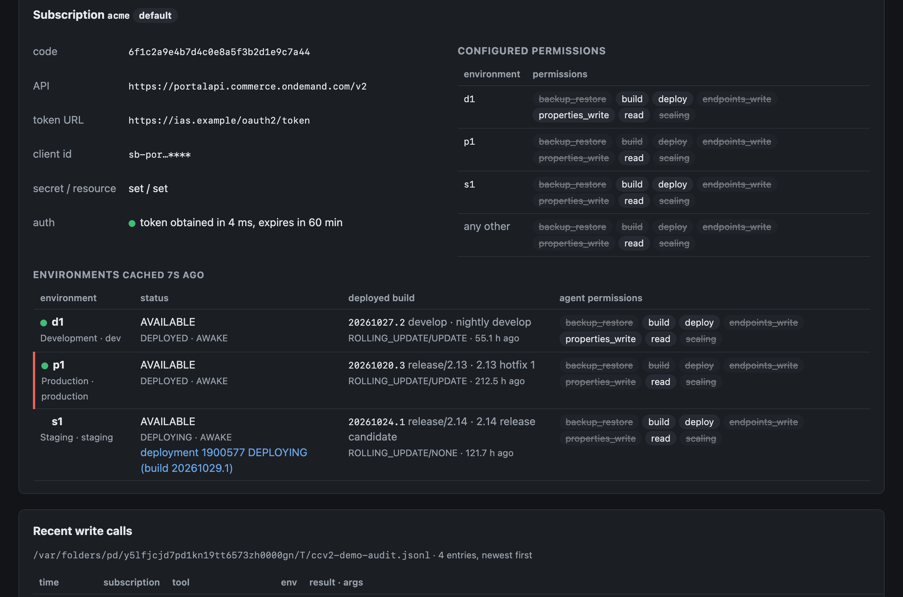
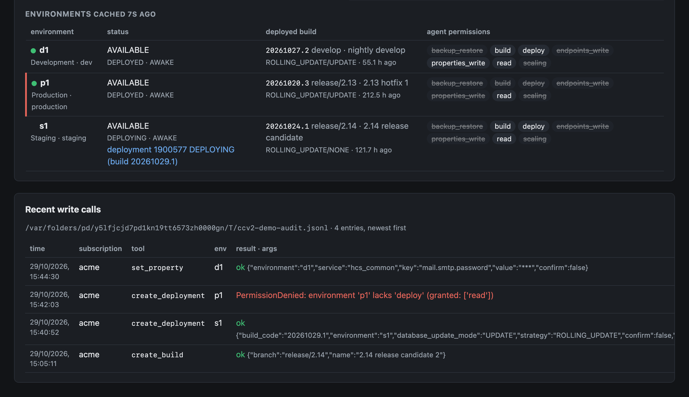

# ccv2-portal-mcp

An [MCP](https://modelcontextprotocol.io/) server for the **SAP Commerce Cloud (CCv2) Cloud
Portal**. It lets an AI assistant such as Claude see and operate the CCv2 control plane the
way a release engineer does: check what is deployed where, trigger builds, deploy with the
right guard rails, read build logs, manage backups, endpoints, certificates, scaling and
hibernation.

Everything goes through SAP's official Cloud Portal API. Nothing is scraped from the UI.

```
"What is deployed on staging and prod right now, and are they on the same branch?"
"Why did build 20260101.1 fail?"
"Run the pre-deploy checklist for p1 with build 20260101.1."
"Deploy it to s1 with a database update, take a quick backup first."
"Put p1 into maintenance mode."
"Roll d1 back to the previous build."
```

## Features

### See

- **What is deployed where**: build, branch, version, who deployed it and when, for every
  environment, with a plain-language comparison and any deployment in progress.
- **Full picture of an environment in one call**: status, services and replicas, the live
  build and branch, scaling, hibernation.
- **Builds and deployments**: list and filter, inspect, progress by stage with the failed
  steps pulled out, allowed deployment modes per environment, blue-green decisions and
  traffic split state.
- **Build logs that fit in a context window**: the portal's log zip is unpacked and you ask
  for the first error, a grep with context, a head or a tail.
- **Build failure diagnosis**: classifies the first error (missing branch, compile, tests,
  Spring context, out of memory, manifest, dependency, transient) with the evidence lines.
- **Properties**: read one, or diff a set of keys between two environments; secret-looking
  values are masked unless you ask.
- **Endpoints, certificates, backups, restores, scaling and scheduled activities**, with
  computed extras such as days to certificate expiry and whether a backup can be restored.
- **Release timeline**: builds and deployments of the last N days in one chronological list.

### Act

- **Builds**: trigger from a branch or tag.
- **Deployments**: rolling update, recreate or blue-green, with `NONE` / `UPDATE` /
  `INITIALIZE` database modes; cancel a running deployment (with optional database
  rollback); accept or reject a green deployment; set the canary traffic split.
- **Backup before deploy**: one flag takes a quick database backup and deploys only once it
  is restorable.
- **Rollback**: redeploys the previous build; shows the plan first, executes on confirm.
- **Pre-deploy checklist**: availability, hibernation, permissions, running deployment, build
  status and branch naming, allowed modes, backup age, maintenance mode, certificate expiry,
  pending blue-green decision. One `ready` flag.
- **Maintenance mode** for all endpoints of an environment, or a chosen subset, in one call.
- **Certificates**: upload PEM material, rotate across endpoints with a domain check, delete
  when unused.
- **Properties**: set a customer property on a service.
- **Backups and restores**: quick or standard backups, cancel, delete, restore into the same
  or another environment (data refresh), cancel a restore.
- **Scaling and hibernation**: change scaling within the portal's allowed values; schedule,
  reschedule and cancel hibernation, wake-up and DR activities.
- **Bounded waits**: `wait_for_build`, `wait_for_deployment` and `wait_for_backup` poll
  for at most a minute per call and tell the assistant to call again.

### Stay safe

- **Per-environment permissions**, read-only by default: `read`, `build`, `deploy`,
  `properties_write`, `endpoints_write`, `backup_restore`, `scaling`. Environments without
  a grant are invisible or read-only, as you choose.
- **Confirmation** (`confirm=true`) for production deployments, `INITIALIZE`, `RECREATE`,
  cancellations, restores, deletions and scaling changes, mirroring the portal's own CONFIRM
  prompt.
- **Validation before writes**: a deployment is refused when the build did not succeed,
  another deployment is running, or the portal does not allow the chosen mode.
- **Audit log**: every write attempt, including refused ones, is recorded as JSON with
  secrets masked.
- **Portal API quirks handled**: token caching and refresh, the portal's custom auth header,
  HTML login pages detected as auth failures, pagination, 429 retries, RFC 7807 errors with
  plain-language hints.

### Operate

- **Several subscriptions** from one server, each with its own technical user and
  permissions, configured from variables or a JSON file; every tool takes a `subscription`
  argument.
- **Docker or stdio**: a container serving streamable HTTP, or a stdio process started by the
  AI client.
- **Status page**: a read-only page showing the server, the registered tools, each
  subscription's configuration and authentication state, every environment with its
  status, deployed build and the permissions the agent holds there, and the latest write
  calls from the audit log.
- **Smoke script**: runs every read tool against a subscription in one command.

## Status page

Served by the MCP server at `http://localhost:8849/` under streamable HTTP, or by
`ccv2-portal-mcp ui` on `http://127.0.0.1:8850/` for stdio setups. Shown with sample data.





## Quick start

You need a **technical user** on the Cloud Portal (User Management → Technical Users) with
the `CUSTOMER_DEVELOPER` or `CUSTOMER_SYS_ADMIN` role and the environments it may access.
The portal shows its token endpoint URL, client id, client secret and resource once.

```bash
cp .env.example .env        # fill in the technical-user values and the subscription code
docker compose up -d --build
```

The server now listens on `http://localhost:8849/mcp` (streamable HTTP) and serves the
status page at `http://localhost:8849/`. Register it with Claude Code:

```bash
claude mcp add --transport http ccv2-portal http://localhost:8849/mcp
```

Without Docker, for local use over stdio:

```bash
uv run ccv2-portal-mcp
```

```bash
claude mcp add ccv2-portal -- uv --directory /path/to/ccv2-portal-mcp run ccv2-portal-mcp
```

Over stdio there is no HTTP port, so the status page runs as its own process:

```bash
uv run ccv2-portal-mcp ui          # http://127.0.0.1:8850/
```

By default every environment is read-only. Grant more per environment in `.env`:

```
CCV2_PERMISSIONS=d1:read,build,deploy,properties_write;s1:read,build,deploy;p1:read
```

## Documentation

- [docs/tools.md](docs/tools.md): every tool, what it does, which permission it needs and
  when it asks for confirmation.
- [docs/configuration.md](docs/configuration.md): environment variables, multi-subscription
  config, permissions, audit log, running modes, and the portal API gotchas the server
  handles.
- [docs/research.md](docs/research.md): the Cloud Portal API inventory, what the API cannot
  do, the tooling ecosystem and the design decisions behind this project.
- `spec/cloud-portal-api-2.0.12.yaml`: the official OpenAPI spec, extracted from SAP Help.

## Project status

Read tools validated against a live subscription with `scripts/smoke.py`, which runs every
read tool in one command. Builds and rolling deployments with data migration have been run
live through the write tools. The remaining write tools (properties, endpoints,
certificates, backups, restores, scaling, scheduled activities, blue-green, cancellation)
are unit-tested against the API contract but not yet exercised live.

## Development

```bash
uv sync
uv run pytest
```

Tests use an in-memory fake portal; nothing talks to SAP.

## License

MIT
